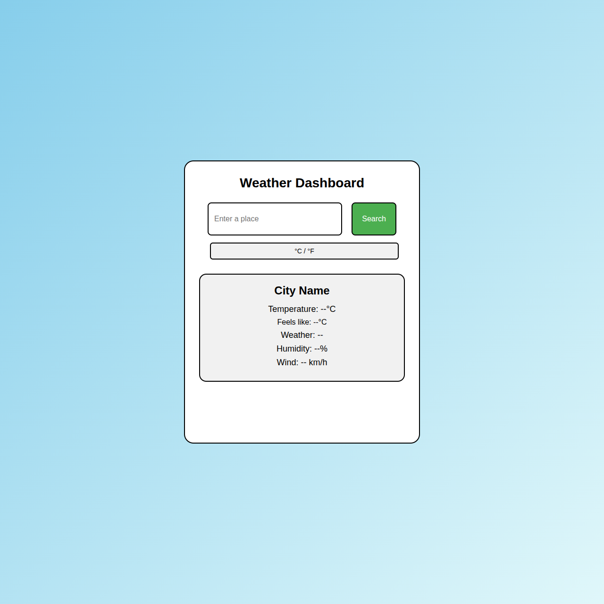

# Weather Dashboard

A simple weather app made with Flask. It shows the weather for any city, gives an AI suggestion, and lets you switch between Celsius and Fahrenheit units.

## Features
- Search any city to see the weather
- See temperature, feels like, humidity, and wind
- Weather icon changes based on the weather
- Background color changes with the weather
- AI suggestion for what to wear or do
- Switch between °C and °F

## How to run

1. Install Flask and requests:
```
pip install flask requests
```

2. Get API keys:
- OpenWeatherMap API key
- Hack Club AI API key

3. Add your keys to Vercel (Environment Variables):
- `API_KEY` = your OpenWeatherMap key
- `AI_KEY` = your Hack Club AI key

4. Run the app:
```
python app.py
```

5. Open `http://127.0.0.1:5000` in your browser.

## Screenshot



## Files
- `app.py` - Main Flask app
- `templates/index.html` - HTML page
- `static/style.css` - Styles
